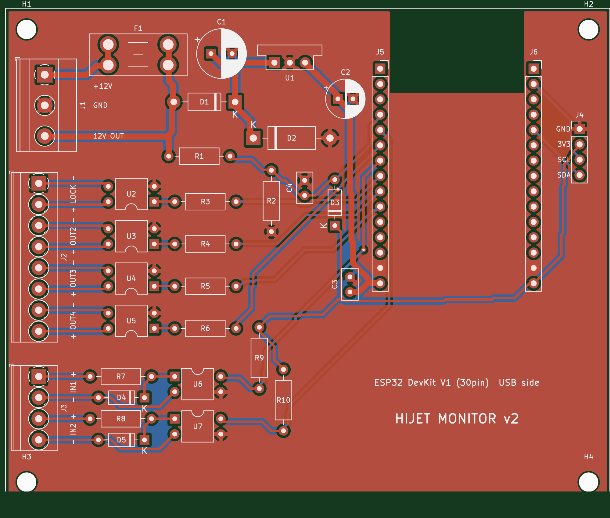

# 基板（ESP32 DevKit V1 30ピン キャリア）

**ESP32 DevKit V1 互換（30 ピン、HW-394、列間 25.4mm）を直接はんだ付けする**、2 層の基板です。部品は TVS（表面実装 4 個）以外すべてリード部品です。
38 ピンの ESP32-DevKitC はピン配置が違うので付けられません。



| 項目 | 内容 |
|---|---|
| 外形 | 98 × 90 mm（100 × 100 mm 以内なので JLCPCB の最安価格）、角に M3 取付穴 ×4 |
| 部品 | 抵抗・ダイオードは足の間隔 5.08 mm で立てて実装。出力の TVS だけ表面実装（SMB、はんだごてで付けられる大きさ） |
| ESP32 | ソケットを使わず直接はんだ付け（振動でソケットが緩むのを防ぐ）。ESP32 の下（隙間 約 2.5mm）には部品を置かない |
| 層 | 2 層（両面に GND ベタ） |
| 最小パターン幅 / 間隔 | 0.4 mm / 0.3 mm（電源系は 1.0 mm） |
| 最小穴径 | 0.4 mm（ビア） |
| 検証 | DRC・ピン照合・部品の収まり・回路シミュレーション・製造データ照合すべて合格。詳しくは [VERIFICATION.md](VERIFICATION.md) |

## 発注するファイル

- **`hijet_starter_gerber.zip`** … ガーバー＋ドリル一式。JLCPCB などにそのままアップロードします。
- 発注時の設定：2 層、FR-4、板厚 1.6 mm、銅厚 1 oz、表面処理は HASL（鉛フリー）、レジストは緑、シルクは白。
- **部品表 `bom.csv`** … 部品ごとに秋月電子通商の商品ページの URL と、買う数を載せています（秋月にない P6KE20A だけ DigiKey）。

> **発注前に必ず確認してください。** `hijet_starter_1to1.pdf` を**原寸（100%・拡大縮小なし）**で印刷し、
> 実物の ESP32 ボードのピンが J5・J6 の穴の位置に合うこと、端子台・ブザー・DC-DC の足が穴に合うことを確かめてください。
> 列の間隔 25.4 mm は、購入したボードをノギスで測った値（外側どうし 26.0 mm）と一致しています。

## 回路

| ブロック | 内容 |
|---|---|
| 電源 | J1「+12V」→ F1 ポリスイッチ MF-RX110/72 または RXEF110（1.1A・72V）→ D1 SB340LS（3A、逆接保護）→ D2 P6KE20A（サージ吸収）・C1 100µF 50V → U1 M78AR05-1（5V 1A、入力 6.5〜32V）→ C2 100µF・C3 0.1µF → ESP32 の 5V ピン |
| 電圧測定 | ヒューズの後ろの 12V → R1 100k / R2 18k で分圧 → GPIO34（16V で 2.44V＝ADC の精度のよい範囲内）。C4 0.1µF でノイズ除去、D3 BAT43 で 3.3V を超えないようクランプ |
| 絶縁出力 ×4 | GPIO25 / 26 / 27 / 32 → 330Ω → PC817（U2〜U5、VCEO 80V）の LED。トランジスタ側を J2 に出す（ESP32 とは電気的に絶縁、各 50mA 以下）。**端子の 2 本の間に双方向 TVS SMBJ45CA（D8〜D11）** |
| 絶縁入力 ×3 | J3 の IN+ → 3.3k → PC817（U6〜U8）→ IN−。1N4148 で逆電圧を保護。出力は GPIO33 / GPIO35 / GPIO36（10k で 3.3V にプルアップ、信号ありで LOW）。3ch 目は ACC（キー ON）検知用。35V まで耐える |
| OBD-II（CAN） | MCP2562FD（U9）。VDD=5V、VIO=3.3V。TXD=GPIO18、RXD=GPIO19。STBY は R15 10k で 3.3V に引いて**既定は待機（車の CAN に一切関与しない）**、GPIO4 を LOW にしたときだけ動作。CAN-H / CAN-L を J7 へ（終端抵抗は付けない） |
| ブザー | GPIO13 → R13 1k → 2SC1815 → 5V 自励式ブザー。R14 10k で起動時は確実に OFF、D7 1N4148 で逆起電力を吸収 |
| GPS | J8：GND / 3V3 / GPS RX（GPIO17 から）/ GPS TX（GPIO16 へ） |
| I2C | J4：GND / 3V3 / SCL(GPIO22) / SDA(GPIO21)。0.96 インチ OLED（SSD1306）モジュールと同じピンの並び |

### 車載向けの保護

| 想定するもの | 対策 |
|---|---|
| バッテリーの逆接続 | D1 SB340LS が電流を止める。入力は 1N4148 で LED を守る。電圧測定は R1 100k で電流を制限 |
| 配線のショート・過電流 | F1 ポリスイッチ（自己復帰型）。トリップするまでの最大 2.2A を流しても D1（3A）は耐える。車両側にもヒューズを入れる |
| 電源ラインのサージ（ノイズ、オルタネーターの急な負荷変動） | D2 P6KE20A が 27.7V 以下に抑える（DC-DC の上限 32V）。長く続くときは F1 が切れて止まる |
| 出力の配線から入るサージ、リレーのコイルの逆起電力 | D8〜D11 SMBJ45CA（双方向）が 72.7V 以下に抑える（フォトカプラの上限 80V） |
| 入力の配線のサージ | 3.3k で電流を制限（35V でも LED 10mA、抵抗の発熱は短時間の許容内） |
| 振動 | ESP32 をソケットでなく直接はんだ付け。電解コンデンサは背の低いもの（C2）を使う。基板は M3 スペーサー 4 本で固定 |

**守れないもの**：24V でのジャンプスタート（トラック用の救援）では D2 が導通して F1 が切れ、装置は止まります（壊れるのを防ぐ動作）。続くと D2 が壊れることがあり、その場合は D2 を交換します。

## 端子の使い方

端子台はすべて 5.08mm ピッチです。J2 は 2P を 4 個、J3 は 2P を 3 個、横にスライドさせて連結してから基板に挿します。

| 端子 | ピン | つなぐ先 |
|---|---|---|
| J1 | +12V | ヒューズ電源（常時電源）。車両側にもヒューズを入れる |
|  | GND | ボディアース |
|  | OUT | ヒューズ通過後の 12V（予備入力の IN+ 用） |
| J2 | LOCK − / + | 車両の施錠信号（GND に落とすと施錠するタイプ）。＋を信号線、−を GND へ。線は配線図か取付店で必ず確認する。**＋と−を逆につながない**（フォトカプラは逆向きの電圧に 6V までしか耐えない） |
|  | OUT2〜OUT4 − / + | 汎用。作業灯などはリレーモジュールの入力につなぐ（直接は駆動できない） |
| J3 | IN1 + / − | 例：ドアの開閉信号（スイッチが GND に落ちるタイプ）は、IN+ を J1 の「OUT」へ、IN− をドアの信号線へつなぐ |
|  | ACC + / − | ACC（キー ON で 12V）の線を ACC+ に、ACC− を GND に |
| J7 | CAN H / L / G | OBD-II コネクタの 6 番（CAN-H）、14 番（CAN-L）、4・5 番（GND）。市販の OBD-II 延長ケーブルを切って使うと楽 |
| J8 | GND 3V3 GPS RX / TX（上から） | NEO-6M など UART の GPS モジュール。GPS RX の端子をモジュールの RX に、GPS TX の端子をモジュールの TX につなぐ |
| J4 | GND 3V3 SCL SDA（上から） | OLED や温度センサー（BME280 など）。四角いパッドが GND |

## 組み立て

部品表は `bom.csv` です。部品番号は基板のシルク印刷と同じです。

1. **最初に TVS（D8〜D11）** を付けます。表面実装なので、片方のパッドに少しはんだを盛り、ピンセットで部品を押さえて温め、反対側を付けます。向きはありません（双方向）。
2. 背の低い部品から順にはんだ付けします：抵抗 → ダイオード → フォトカプラ・MCP2562 → セラミックコンデンサ → トランジスタ → ピンヘッダー（J4・J8）→ ポリスイッチ → 電解コンデンサ → ブザー → 端子台 → DC-DC。
3. **向きのある部品に注意してください。**
   - ポリスイッチ（F1）：本体が大きい（幅 12.8mm）ので、基板の上の端に横向きに付ける。向きはない。
   - ダイオード（D1〜D7）：立てて付ける。本体を丸いシルクの穴の上に立て、**帯（カソード）を上にして**、上から折り返した足を「K」の四角いパッドへ。
   - 電解コンデンサ（C1・C2）：長い足（＋）を、シルクの「+」がある四角いパッドに。
   - フォトカプラ（U2〜U8）：本体の 1 番ピンの丸印を、四角いパッドに合わせる。
   - M78AR05-1（U1）：1 番ピン（Vin）を四角いパッドに。
   - MCP2562（U9）：本体の 1 番ピンの丸印（切り欠き側）を四角いパッドに。
   - 2SC1815（Q1）：左のパッドから E-C-B。シルクの半円が本体の丸い側。足の並びが違うトランジスタは使わない。
   - 抵抗：立てて付ける。どちら向きでもよい（本体を丸いシルクの穴の上に立てる）。
   - ブザー（BZ1）：＋表示の足（長い足）を「+」の四角いパッドに。
4. **ESP32 を付ける前に**、J1 に 12V をつないで、J5 の 15 番ピン（いちばん下、ESP32 の VIN）と GND の間が約 5V になることをテスターで確認します。
5. ESP32 ボードを **USB コネクタが基板の下側（「USB cable keep clear」の文字の方）**、VIN の列が左（J5）に来る向きで挿し、ボードを基板に押し付けたまま（ピンの樹脂が基板に当たるまで）四隅のピンを先にはんだ付けしてから、残りのピンを付けます。直接はんだ付けなので、後から外すのは大変です。向きを 2 回確かめてから付けてください。
6. ESP32 に USB で書き込むときは、J1 の 12V を外してください（両方から同時に給電しないため）。USB ケーブルのプラグは基板の上を通るので、「USB cable keep clear」の場所には何も置かないでください。

## 作り直すとき

`./build.sh` は、生成のあとに DRC・ピン照合（`check_pins.py`）・部品の収まり（`check_mech.py`）・回路シミュレーション（`sim/`、ngspice が必要）・製造データ照合（`check_fab.py`）を実行し、1 つでも問題があれば止まります。

```
./build.sh   # 生成 → 検証（DRC・ピン・収まり・回路・製造データ）→ ガーバー/ドリル → zip → BOM → 原寸 PDF → プレビュー
```

KiCad 7（`kicad-cli` と Python の `pcbnew`）と numpy が必要です。部品の位置と接続先は `gen_pcb.py` の上の方にまとめてあります。
配線は簡易オートルーターで引いているので、部品を動かしたら必ず `./build.sh` で DRC を通してください。
