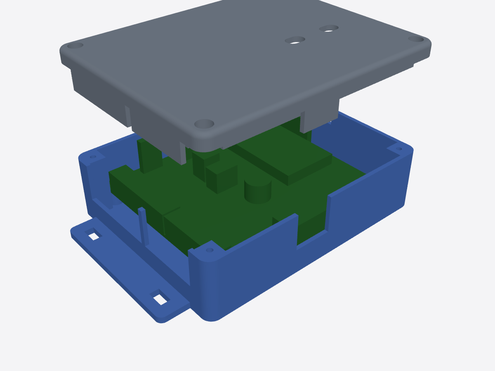

# ケース（Bambu Lab A1 mini 用）

基板 v4（98×90mm）を入れる、出っ張りのない四角い箱（外側の縦の角は半径 5mm、ふたの上の縁は半径 2mm で丸めてある）。左右を 8.5mm ずつ広げ、内側の角にふたのねじの柱を立てている。本体とふたの 2 つ。どちらも A1 mini（180×180×180mm）に収まり、サポートなしで印刷できる。

| ファイル | 中身 | 大きさ |
|---|---|---|
| `case_base.stl` | 本体（底を下にして印刷） | 箱 119 × 95 mm、高さ 29.6 mm（左右の取り付けのつばを含めると幅 147 mm） |
| `case_lid.stl` | ふた（上面を下にした向きで出力してある） | 119 × 95 × 15.5 mm |
| `gen_case.py` | 生成スクリプト（寸法は先頭の定数） | `python3 gen_case.py`（manifold3d・trimesh が必要） |

向き：上から見て、J1（電源）の切り欠きが奥、J7（CAN）が手前、J2・J3 が左、センサーが右（基板のシルクの文字が読める向き）。`gen_case.py` は書き出すたびにこの向きを確かめる。

## 印刷の設定

| 項目 | 設定 |
|---|---|
| 材料 | **PETG**（車内は夏に 60℃ を超える。PLA は柔らかくなって変形する）。ASA は A1 mini では反りやすい |
| 積層 | 0.2mm |
| 壁 | 3 周以上（ねじ穴のまわりを丈夫にする） |
| インフィル | 20〜25% |
| サポート | なし |
| 時間の目安 | 本体 約 3 時間、ふた 約 1.5 時間 |

## 組み立て

| 箇所 | ねじ |
|---|---|
| 基板 → 本体の柱（4 か所） | M3×10 なべ小ねじ（部品表のもの）。柱の下穴 2.6mm に直接ねじ込む |
| ふた → 本体の内側の角の柱（4 か所） | M3×10。頭はふたの座ぐりに沈み、柱に 7mm 入る |
| 車への取り付け | 左右のつばの長穴（幅 4.5mm）に M4 ねじか結束バンド |

1. 基板を本体に入れ、4 本のねじで留める。基板の裏に出た足と底の間は約 8mm。
2. 端子台に電線をつなぎ、電線を壁の切り欠きに通す（J1 電源＝上、J7 CAN＝下、J2 出力・J3 入力＝左、センサーのケーブル＝右）。
3. ふたをかぶせる。ふたの外周の壁（高さ 4mm）が本体の壁の続きになり、舌が切り欠きの上側をふさいで、電線の通るすき間（高さ約 8.5mm）だけが残る。
4. ふたを 4 本のねじで留める。

## 注意

- **BOOT・EN ボタンの穴**（ふたの長穴 2 つ）は、DevKit の外形からの推定の位置。つまようじで押す。ずれていたら `gen_case.py` の `BUTTONS` を直して作り直す。
- **USB はケースの外に出ない**（DevKit の USB が基板の内側を向いているため）。更新は遠隔更新で行う。USB でつなぐときは、ふたを外す。
- **BME280（温度）と GPS はケースの外**に出す（中の熱と、空が見えないと測位できないため）。MPU6050 は中に入れてもよい。
- 端子台のねじはふたを外して締める。
- 電線の切り欠きのすき間は、必要ならスポンジテープでふさぐ（ほこり・虫よけ）。
- 寸法は部品の公称値からの計算。**実物で確かめていない。** 1 回目は試しに印刷して、基板が入るか・ねじ穴が合うかを見ること。
