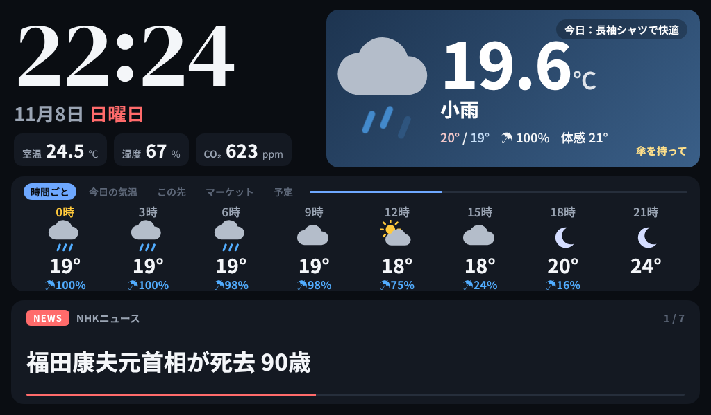

# Fire タブレットで YouTube ライブを流し続ける／カラーのサイネージにする

同じ NAS のサーバーが、Fire のブラウザ向けに 2 つのページを配信する。どちらか（または両方を別の端末で）使う。

| ページ | 内容 |
|---|---|
| `http://<NASのIP>:8090/live` | **YouTube のライブを全画面で流し続ける**（下の「YouTube ライブ」） |
| `http://<NASのIP>:8090/fire` | Kindle ダッシュボードのカラー版（その下の「ダッシュボード」） |

Fire に表示する方法（Fully Kiosk Browser の設定など）は両方共通で、「2. Fire に表示する」を参照。

# YouTube ライブ（/live）

チャンネルを設定しておくと、NAS がそのチャンネルの**今のライブを 5 分ごとに探して**、Fire はそれを全画面で流す。

- 配信が切れて再開し、動画 ID（URL）が変わっても自動で新しい配信に切り替わる
- 配信していない間は「配信を待っています」を出して待つ。始まれば自動で流れる
- 止まった・回線が詰まった → 自動で再生し直す。1 分以上遅れたらライブの最新に飛ぶ
- 画面をタップすると音の ON/OFF
- 12 時間ごとにページを読み込み直す（つけっぱなし対策）
- YouTube 公式の埋め込みプレーヤーで流す（API キー不要）

## 設定

NAS の `config/config.json` に足して、Container Manager でプロジェクトを再起動:

```json
"live": {
  "channel": "@weathernews",
  "mute": true,
  "clock": false
}
```

| 項目 | 内容 |
|---|---|
| `channel` | チャンネル。`@ハンドル`・`UC…` で始まるチャンネル ID・チャンネルの URL のどれでもよい |
| `video` | 特定のライブを固定で流すとき（動画 ID や `https://youtu.be/…` の URL）。書くと `channel` より優先 |
| `mute` | `true` で消音のまま流す。`false` で音あり（下の注意） |
| `clock` | `true` で右下に小さく時計 |
| `check_minutes` | 今のライブを調べ直す間隔（既定 5 分。無音で切り替えるなら 2 がおすすめ） |
| `fallbacks` | 無音・停止のときの切り替え先（下の「無音になったら…」） |

**音を出したいとき**: ブラウザは「音ありの自動再生」を止めることがある。止められたら消音で流し始めて
「タップで音を出せます」と出るので、一度タップする。Fully Kiosk Browser なら Web Content Settings →
**Autoplay Videos** を ON にすると、最初から音ありで流せる。

## 無音になったら別のチャンネルに切り替える

いつもの配信が**無音のまま続いたら**（または配信が止まったら）、`fallbacks` に書いた配信に切り替え、
音が戻ったら自動でいつもの配信に戻す。

```json
"live": {
  "video": "https://www.youtube.com/live/Odz4oWGT4NY",
  "fallbacks": ["@切り替え先のチャンネル", "https://www.youtube.com/live/動画ID"],
  "check_minutes": 2,
  "silence": {"threshold_db": -50, "seconds": 15, "switch_after": 2},
  "mute": false
}
```

- **仕組み**: NAS が `check_minutes` ごとに、いつもの配信の音声を `seconds` 秒だけ聞いて音量を測る（Fire 側では測れないため）。
  最大音量が `threshold_db` 未満の回が `switch_after` 回続いたら無音とみなす。上の設定なら**無音が約 4 分続くと切り替わる**。
- **切り替え先**: `fallbacks` を上から順に見て、配信中で音が出ているものを流す。全部無音なら、配信中の最初のもの。
- **戻るとき**: 切り替え中もいつもの配信を測り続け、音が戻った回の次で元に戻す。
- 切り替わると Fire の画面下に「無音が続いているため、別の配信に切り替えました」と出る。
- 音量を測れないとき（ffmpeg が無い、YouTube から音声が取れない）は**切り替えない**（いつもの配信のまま）。
  理由は `http://<NASのIP>:8090/live.json` の `note` に、最後に測った音量は `level_db` に出る。
- 小さな BGM でも「音あり」と判定させたいなら `threshold_db` を下げる（例 `-60`）。
  「ほぼ無音」でも切り替えたいなら上げる（例 `-40`）。完全な無音は −91 dB 前後。
- 通信量: 1 回の測定で最も軽い画質の配信を 15 秒受け取る（1 回 0.5MB 前後、2 分ごとで 1 日 0.4GB 程度）。
- ffmpeg は Docker イメージに入っている（NAS でプロジェクトを**ビルドし直す**と入る）。

## うまくいかないとき（ライブ）

| 画面の表示 | 原因と対処 |
|---|---|
| 流すライブが設定されていません | `config.json` の `live.channel` を書いて再起動 |
| 配信を待っています | 今そのチャンネルは配信していない。`channel` の綴りも確認（`/health` の `live` に取得エラーが出る） |
| このライブは埋め込み再生が許可されていません | 配信者が埋め込みを禁止している。そのライブはこの方法では流せないので別のチャンネルに |
| YouTube がこのページからの再生を受け付けません | YouTube の URL を直接開いていないか確認。必ず NAS の `/live` から開く |
| YouTube に接続できません | Fire のインターネット接続を確認（1 分ごとに自動で再試行） |
| カクつく | Fire 7 は性能が控えめ。YouTube が回線と端末に合わせて画質を下げるので、しばらく待つと落ち着くことが多い |

# ダッシュボード（/fire）

Kindle ダッシュボードのカラー版。

Kindle ダッシュボードと同じ NAS のサーバーが、ブラウザ用のカラー版も配信する。
Fire 側はブラウザで `http://<NASのIP>:8090/fire` を開いて全画面にするだけで、脱獄・改造は要らない。



（1024×600 の横置き。ダミーデータで表示: `http://<NASのIP>:8090/fire?demo=1`）

## 画面の作り

少し離れても読めるよう、**いつも見たいものは大きく固定**し、それ以外は **1 つずつ大きく順番に**出す。

| 場所 | 内容 |
|---|---|
| 左上（固定） | 時計（秒でコロンが点滅）・日付（祝日名つき）・室内（室温・湿度・CO₂。乾燥・多湿・CO₂ 1000ppm 以上は黄色の枠） |
| 右上（固定） | 今の天気。**背景の色が天気と昼夜で変わる**（晴れ＝青、雨＝藍、夜＝紺 など）。服装のひとこと・傘の注意 |
| 中段（10 秒ごとに切り替え） | 時間ごと → 今日の気温グラフ → この先 3 日 → マーケット → 予定。データが無いものは飛ばす。**タップで次へ** |
| 下段（8 秒ごとに切り替え） | ニュースのヘッドラインを 1 本ずつ大きく（2 行まで）。**タップで次へ** |

切り替えの間隔は `fire.html` の先頭近くの `PANEL_SEC`（中段）・`HEADLINE_SEC`（ヘッドライン）で変えられる。

## Kindle 版との違い

| | Kindle（E-ink） | Fire（液晶） |
|---|---|---|
| 表示 | サーバーが描いた PNG を毎分貼る | ブラウザがページを表示し、データ（`/data.json`）だけ毎分取りに来る |
| 時計 | 分単位 | 秒単位（コロンが点滅） |
| 色 | 16 階調グレー | カラー（ダークテーマ＋天気で色が変わるカード） |
| 予定 | 3〜9 時だけニュース欄を月表示に | 「今日から 1 週間の予定」を中段で順番に出す（カレンダー設定時のみ） |
| ニュース | 7 件を一覧 | 1 本ずつ大きく、8 秒ごとに送る |
| 夜 | — | 23〜6 時は画面を暗く（設定で変更可） |

データの取得（天気・市況・ニュース・SwitchBot・カレンダー）は Kindle と共通なので、両方つないでも API の回数は増えない。

## 1. NAS のサーバーを更新する

1. `dist/kindle-dashboard-nas.zip` を展開し、**`dashboard/` フォルダと `Dockerfile`** を NAS の `docker/kindle-dashboard/` に上書きコピー
   （`config/` と `.env` はそのまま。`dashboard/` に `live.html`・`live.py`・`fire.html`・`web.py` が増え、`Dockerfile` で ffmpeg が入る）。
2. Container Manager → プロジェクト → 停止 → **ビルド** → 起動（SSH なら `docker compose up -d --build`）。
3. PC のブラウザで確認:
   - `http://<NASのIP>:8090/health` の `version` が `2026.11.08-live-fallback`
   - `http://<NASのIP>:8090/live`（ライブ）・`/fire`（ダッシュボード）に画面が出る

## 2. Fire に表示する

### いちばん簡単（Silk ブラウザ）

1. Fire の Silk ブラウザで `http://<NASのIP>:8090/live`（ダッシュボードなら `/fire`）を開く。
2. メニュー → 「ホーム画面に追加」でアイコンを作っておく。
3. 画面が消えないようにする: 設定 → デバイスオプション → **シリアル番号を 7 回タップ** → 開発者オプション →
   **「スリープモードにしない（充電中）」を ON**。

Silk はアドレスバーが出たり、再起動後に自動で開かなかったりするので、置きっぱなしにするなら下の方法がおすすめ。

### おすすめ（Fully Kiosk Browser）

壁掛け・置きっぱなし用の全画面ブラウザ。Amazon アプリストアには無いので、公式サイトから APK を入れる。

1. 設定 → セキュリティとプライバシー → **提供元不明のアプリ** → Silk を許可。
2. Silk で `https://www.fully-kiosk.com/` を開き、Fully Kiosk Browser の APK をダウンロードしてインストール。
3. Fully を開いて設定:
   - **Start URL**: `http://<NASのIP>:8090/live`（ダッシュボードなら `/fire`）
   - Web Content Settings → **Enable JavaScript Interface** を ON（夜に本体の明るさを下げるのに使う）
   - Device Management → **Keep Screen On** を ON、**Screen Orientation** を Landscape
   - Device Management → **Launch on Boot** を ON（停電・再起動のあと自動で表示）
   - 全画面: Web Browsing Settings の Fullscreen Mode / Hide Status Bar / Hide Navigation Bar を ON
4. 戻ると全画面で表示される。設定画面へは画面左端から右へスワイプ。

※ 機能によっては有料版（PLUS ライセンス）が必要になる。上の設定は無料版で使える範囲のつもりだが、
  使えない項目があればその項目だけ飛ばしてよい（JavaScript Interface が無いと、夜は画面を暗い色にするだけになる）。

## 3. 設定（任意）

NAS の `config/config.json` に足す（書かなければ下の値）:

```json
"web": {
  "night": ["23:00", "06:00"],
  "brightness": {"day": 180, "night": 10}
}
```

- `night`: 画面を暗くする時間帯。暗くしないなら `"night": []`
- `brightness`: Fully Kiosk のときの本体の明るさ（0〜255）

時計の数字のフォントは Kindle と同じ `clock.font` を使う。変えたら Container Manager でプロジェクトを再起動。

## 置き方のヒント

- **横置き専用**。縦にすると上下が空く。
- 24 時間つけっぱなしで充電し続けると、電池が膨らむことがある。ときどき様子を見る。
  気になるなら、スマートプラグで 1 日数時間だけ給電を切る。
- 画面の焼き付きは液晶なのでほぼ心配ないが、夜間は暗くしておくと長持ちする。

## うまくいかないとき

| 症状 | 対処 |
|---|---|
| 左上に「サーバーに接続できません」 | NAS の IP・ポート（8090）を確認。最後に取得したデータは表示し続ける |
| 左上に「取得失敗: 天気」など | その項目だけ取得できていない。`/health` で理由を確認 |
| 日本語が四角になる / 文字が細い | 初回はフォント（約 9MB）を NAS から読み込むので数秒かかる。時間をおいて再読み込み |
| 時刻がずれる | 時計は NAS の時刻に合わせている。NAS の時刻（NTP）を確認 |
| 画面が消える | Fully なら Keep Screen On、Silk なら開発者オプションの「スリープモードにしない」 |
