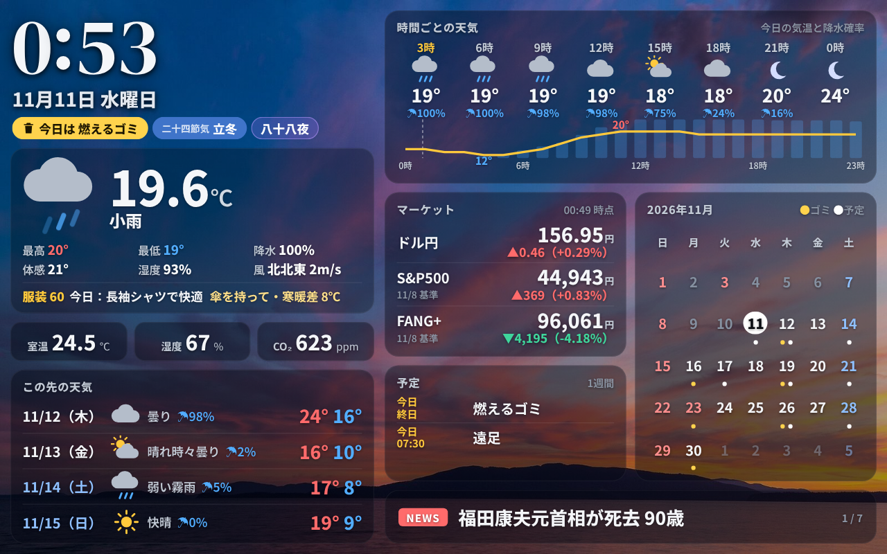
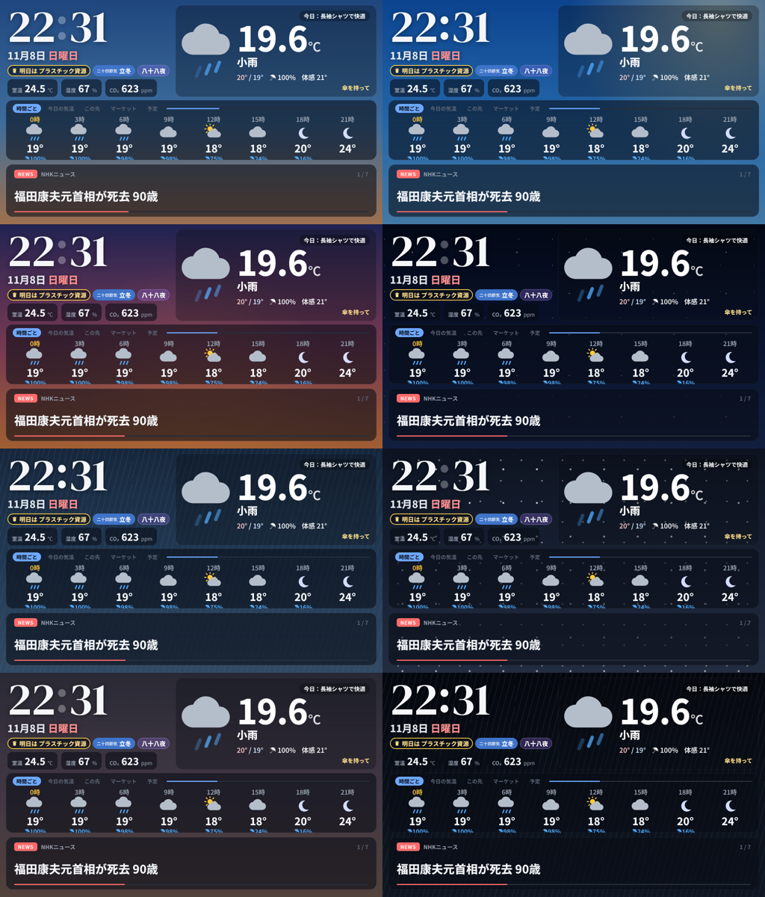

# Fire タブレットで YouTube ライブを流し続ける／カラーのサイネージにする

同じ NAS のサーバーが、Fire のブラウザ向けに 2 つのページを配信する。どちらか（または両方を別の端末で）使う。

| ページ | 内容 |
|---|---|
| `http://<NASのIP>:8090/live` | **YouTube のライブを全画面で流し続ける**（下の「YouTube ライブ」） |
| `http://<NASのIP>:8090/fire` | Kindle ダッシュボードのカラー版（その下の「ダッシュボード」） |

Fire に表示する方法（Fully Kiosk Browser の設定など）は両方共通で、「2. Fire に表示する」を参照。

# YouTube ライブ（/live）

チャンネルを設定しておくと、NAS がそのチャンネルの**今のライブを 5 分ごとに探して**、Fire はそれを全画面で流す。

- 配信が切れて再開し、動画 ID（URL）が変わっても自動で新しい配信に切り替わる
- 配信していない間は「配信を待っています」を出して待つ。始まれば自動で流れる
- 止まった・回線が詰まった → 自動で再生し直す。1 分以上遅れたらライブの最新に飛ぶ
- 画面をタップすると音の ON/OFF
- 12 時間ごとにページを読み込み直す（つけっぱなし対策）
- YouTube 公式の埋め込みプレーヤーで流す（API キー不要）

## 設定

NAS の `config/config.json` に足して、Container Manager でプロジェクトを再起動:

```json
"live": {
  "channel": "@weathernews",
  "mute": true,
  "clock": false
}
```

| 項目 | 内容 |
|---|---|
| `channel` | チャンネル。`@ハンドル`・`UC…` で始まるチャンネル ID・チャンネルの URL のどれでもよい |
| `video` | 特定のライブを固定で流すとき（動画 ID や `https://youtu.be/…` の URL）。書くと `channel` より優先 |
| `mute` | `true` で消音のまま流す。`false` で音あり（下の注意） |
| `clock` | `true` で右下に小さく時計 |
| `check_minutes` | 今のライブを調べ直す間隔（既定 5 分。無音で切り替えるなら 2 がおすすめ） |
| `fallbacks` | 無音・停止のときの切り替え先（下の「無音になったら…」） |

**音を出したいとき**: ブラウザは「音ありの自動再生」を止めることがある。止められたら消音で流し始めて
「タップで音を出せます」と出るので、一度タップする。Fully Kiosk Browser なら Web Content Settings →
**Autoplay Videos** を ON にすると、最初から音ありで流せる。

## 無音になったら別のチャンネルに切り替える

いつもの配信が**無音のまま続いたら**（または配信が止まったら）、`fallbacks` に書いた配信に切り替え、
音が戻ったら自動でいつもの配信に戻す。

```json
"live": {
  "video": "https://www.youtube.com/live/Odz4oWGT4NY",
  "fallbacks": ["@切り替え先のチャンネル", "https://www.youtube.com/live/動画ID"],
  "check_minutes": 2,
  "silence": {"threshold_db": -50, "seconds": 15, "switch_after": 2},
  "mute": false
}
```

- **仕組み**: NAS が `check_minutes` ごとに、いつもの配信の音声を `seconds` 秒だけ聞いて音量を測る（Fire 側では測れないため）。
  最大音量が `threshold_db` 未満の回が `switch_after` 回続いたら無音とみなす。上の設定なら**無音が約 4 分続くと切り替わる**。
- **切り替え先**: `fallbacks` を上から順に見て、配信中で音が出ているものを流す。全部無音なら、配信中の最初のもの。
- **戻るとき**: 切り替え中もいつもの配信を測り続け、音が戻った回の次で元に戻す。
- 切り替わると Fire の画面下に「無音が続いているため、別の配信に切り替えました」と出る。
- 音量を測れないとき（ffmpeg が無い、YouTube から音声が取れない）は**切り替えない**（いつもの配信のまま）。
  理由は `http://<NASのIP>:8090/live.json` の `note` に、最後に測った音量は `level_db` に出る。
- 小さな BGM でも「音あり」と判定させたいなら `threshold_db` を下げる（例 `-60`）。
  「ほぼ無音」でも切り替えたいなら上げる（例 `-40`）。完全な無音は −91 dB 前後。
- 通信量: 1 回の測定で最も軽い画質の配信を 15 秒受け取る（1 回 0.5MB 前後、2 分ごとで 1 日 0.4GB 程度）。
- ffmpeg は Docker イメージに入っている（NAS でプロジェクトを**ビルドし直す**と入る）。

## うまくいかないとき（ライブ）

| 画面の表示 | 原因と対処 |
|---|---|
| 流すライブが設定されていません | `config.json` の `live.channel` を書いて再起動 |
| 配信を待っています | 今そのチャンネルは配信していない。`channel` の綴りも確認（`/health` の `live` に取得エラーが出る） |
| このライブは埋め込み再生が許可されていません | 配信者が埋め込みを禁止している。そのライブはこの方法では流せないので別のチャンネルに |
| YouTube がこのページからの再生を受け付けません | YouTube の URL を直接開いていないか確認。必ず NAS の `/live` から開く |
| YouTube に接続できません | Fire のインターネット接続を確認（1 分ごとに自動で再試行） |
| カクつく | Fire タブレットは性能が控えめ。YouTube が回線と端末に合わせて画質を下げるので、しばらく待つと落ち着くことが多い |

# ダッシュボード（/fire）

Kindle ダッシュボードのカラー版。

Kindle ダッシュボードと同じ NAS のサーバーが、ブラウザ用のカラー版も配信する。
Fire 側はブラウザで `http://<NASのIP>:8090/fire` を開いて全画面にするだけで、脱獄・改造は要らない。



（Fire HD 8 の 1280×800 横置き。ダミーデータで表示: `http://<NASのIP>:8090/fire?demo=1`）

画面の縦横比に合わせて高さが伸び縮みするので、Fire HD 8（16:10）は上下の帯なしで全面に出る。
Fire 7（1024×600）など他の Fire でもそのまま使える。

## 画面の作り

いつも見たい情報を**全部一度に**並べる（切り替わるのはニュースのヘッドラインだけ）。

| 場所 | 内容 |
|---|---|
| 左上 | 時計（秒でコロンが点滅）・日付・**今日のお知らせ**（ゴミの日・祝日・二十四節気・雑節。下で説明） |
| 左 | 今の天気（気温・天気・最高/最低・降水確率・体感・湿度・風・服装のひとこと・傘や寒暖差の注意） |
| 左 | 室内（室温・湿度・CO₂。乾燥・多湿・CO₂ 1000ppm 以上は黄色の枠） |
| 左下 | この先の天気（収まるだけ。Fire HD 8 で 4 日、Fire 7 で 3 日） |
| 右上 | 時間ごとの天気（3 時間ごと 8 コマ）と今日の気温・降水確率のグラフ（点線が今） |
| 右 中 | マーケット（3 銘柄）・予定（今日から 1 週間。収まるだけ）・**今月のカレンダー**（今日は白丸、日曜・祝日は赤、土曜は青、黄色の点＝ゴミの日、白い点＝予定のある日） |
| 右下 | ニュースのヘッドラインを 1 本ずつ、8 秒ごとに差し替え（タップで次へ） |
| 背景 | 天気 × 朝・昼・夕方・夜で変わる（下で説明） |

- どのカードも、はみ出す行は出さない（画面の大きさに合わせて行数が変わる）。
- ヘッドラインの間隔は `fire.html` の先頭近くの `HEADLINE_SEC` で変えられる。
- 予定が無い（Google カレンダー未設定）ときは、マーケットの下の予定欄を出さずにマーケットを縦いっぱいに使う。

### 背景（天気 × 朝・昼・夕方・夜）

画面全体の背景が、今の天気（晴れ・晴れ時々曇り・曇り・霧・雨・雷・雪）と時間帯で変わる（ゆっくり入れ替わる）。

- 時間帯: **朝**（日の出〜9 時）・**昼**（9〜16 時）・**夕方**（16 時〜日の入り）・**夜**（日の入り〜日の出。天気予報の昼夜で判定）
- 雨・雷は斜めの雨筋、雪は降る雪、晴れた夜は星、晴れた昼は日差し、晴れた夕方は夕焼けがうっすら動く
- 確認用: `/fire?demo=1&sky=rain-evening` のように `天気-時間帯` を付けるとその背景で表示（天気は clear / partly / cloudy / fog / rain / thunder / snow、時間帯は morning / day / evening / night）



### 背景を写真にする

NAS の `config/` フォルダの中に **`backgrounds`** フォルダを作り、写真を置くと背景が写真になる
（`docker/kindle-dashboard/config/backgrounds/`）。置いた写真はページの再読み込み（または 1 分以内）で使われる。再起動は不要。

**ファイル名で、いつ使うかを決める**（小文字の英字。拡張子は .jpg / .jpeg / .png / .webp、大文字の .JPG も可）:

| 天気 | 名前 |  | 時間帯 | 名前 |
|---|---|---|---|---|
| 晴れ | `clear` | | 朝（日の出〜9 時） | `morning` |
| 晴れ時々曇り | `partly` | | 昼（9〜16 時） | `day` |
| 曇り | `cloudy` | | 夕方（16 時〜日の入り） | `evening` |
| 霧 | `fog` | | 夜 | `night` |
| 雨 | `rain` | | | |
| 雷 | `thunder` | | | |
| 雪 | `snow` | | | |

- `clear-day.jpg`（晴れの昼）・`rain-night.jpg`（雨の夜）のように **天気-時間帯**
- `rain.jpg`（雨ならいつでも）・`night.jpg`（夜ならどの天気でも）・`default.jpg`（何にも当てはまらないとき）も使える
- 探す順番: 例えば雨の夜なら `rain-night` → `rain` → `night` → `default` → 無ければ色のグラデーション
  - 晴れ時々曇りは晴れの写真、雷は雨の写真、霧と雪は曇りの写真でも代わりに使う
- 同じ組み合わせを何枚か置くなら `clear-day-2.jpg`, `clear-day-3.jpg` … → **1 時間ごとに入れ替わる**
- スマホで撮った大きな写真をそのまま置いてよい（NAS が画面に合わせて 1600×1000 に切り抜き・縮小して送る）
- 写真の上でも文字が読めるよう、写真は少し暗くし、カードも少し濃くしている。雨・雪のときは雨筋・雪を重ねる

**最初はこの 8 枚くらいがおすすめ**: `clear-morning`・`clear-day`・`clear-evening`・`night`・`cloudy`・`rain`・`snow`・`default`

写真は自分で撮ったもののほか、無料で使える写真サイト（Unsplash・Pexels など。「blue sky」「sunset」「rainy window」
「snow landscape」「night city」などで探せる）からダウンロードしてもよい。各サイトの利用条件は確認すること。

### 今日のお知らせ（日付の下）

| 表示 | いつ |
|---|---|
| 🗑 **今日は 燃えるゴミ**（黄色・点滅） | ゴミの日の朝。`garbage.until`（既定 9:00）を過ぎると控えめになり、12 時で消える |
| 🗑 明日は 〇〇（黄色の枠） | 前の日の `garbage.evening`（既定 17:00）から |
| 祝日（赤） | 祝日 |
| 二十四節気（季節の色: 春=緑・夏=青緑・秋=橙・冬=青） | 立春・春分・立冬など、その日だけ。太陽の位置から計算するので毎年の設定は不要 |
| 雑節（紫） | 節分・彼岸入り／明け・八十八夜・入梅・半夏生・土用入り・二百十日 |

ゴミの日は NAS の `config/config.json` に書く（自治体のゴミカレンダーを見て）:

```json
"garbage": {
  "until": "08:30",
  "evening": "17:00",
  "rules": [
    {"name": "燃えるゴミ", "weekdays": ["月", "木"]},
    {"name": "プラスチック資源", "weekdays": ["水"]},
    {"name": "不燃ゴミ", "weekdays": ["金"], "weeks": [2, 4]},
    {"name": "粗大ゴミ", "dates": ["2026-11-20"]}
  ],
  "except": ["12-31", "01-01", "01-02", "01-03"]
}
```

- `weeks`: 第何週か（その曜日が月の何回目か）。`[2, 4]` なら第 2・第 4。省略すると毎週
- `dates`: 決まった日だけのもの。`except`（各ルールの中にも書ける）: その日は出さない（`"MM-DD"` で毎年、`"YYYY-MM-DD"` でその年だけ）
- 書いたら Container Manager でプロジェクトを再起動

## Kindle 版との違い

| | Kindle（E-ink） | Fire（液晶） |
|---|---|---|
| 表示 | サーバーが描いた PNG を毎分貼る | ブラウザがページを表示し、データ（`/data.json`）だけ毎分取りに来る |
| 時計 | 分単位 | 秒単位（コロンが点滅） |
| 色 | 16 階調グレー | カラー（背景が天気と時間帯で変わる） |
| 予定 | 3〜9 時だけニュース欄を月表示に | 今日から 1 週間の予定＋今月のカレンダーを常に出す |
| ニュース | 7 件を一覧 | ヘッドラインを 1 本ずつ、8 秒ごとに送る |
| 夜 | — | 23〜6 時は画面を暗く（設定で変更可） |

データの取得（天気・市況・ニュース・SwitchBot・カレンダー）は Kindle と共通なので、両方つないでも API の回数は増えない。

## 1. NAS のサーバーを更新する

1. `dist/kindle-dashboard-nas.zip` を展開し、**`dashboard/` フォルダと `Dockerfile`** を NAS の `docker/kindle-dashboard/` に上書きコピー
   （`config/` と `.env` はそのまま。`dashboard/` に `live.html`・`live.py`・`fire.html`・`web.py` が増え、`Dockerfile` で ffmpeg が入る）。
2. Container Manager → プロジェクト → 停止 → **ビルド** → 起動（SSH なら `docker compose up -d --build`）。
3. PC のブラウザで確認:
   - `http://<NASのIP>:8090/health` の `version` が `2026.11.10-photos`
   - `http://<NASのIP>:8090/live`（ライブ）・`/fire`（ダッシュボード）に画面が出る

## 2. Fire に表示する

### いちばん簡単（Silk ブラウザ）

1. Fire の Silk ブラウザで `http://<NASのIP>:8090/live`（ダッシュボードなら `/fire`）を開く。
2. メニュー → 「ホーム画面に追加」でアイコンを作っておく。
3. 画面が消えないようにする: 設定 → デバイスオプション → **シリアル番号を 7 回タップ** → 開発者オプション →
   **「スリープモードにしない（充電中）」を ON**。

Silk はアドレスバーが出たり、再起動後に自動で開かなかったりするので、置きっぱなしにするなら下の方法がおすすめ。

### おすすめ（Fully Kiosk Browser）

壁掛け・置きっぱなし用の全画面ブラウザ。Amazon アプリストアには無いので、公式サイトから APK を入れる。

1. 設定 → セキュリティとプライバシー → **提供元不明のアプリ** → Silk を許可。
2. Silk で `https://www.fully-kiosk.com/` を開き、Fully Kiosk Browser の APK をダウンロードしてインストール。
3. Fully を開いて設定:
   - **Start URL**: `http://<NASのIP>:8090/live`（ダッシュボードなら `/fire`）
   - Web Content Settings → **Enable JavaScript Interface** を ON（夜に本体の明るさを下げるのに使う）
   - Device Management → **Keep Screen On** を ON、**Screen Orientation** を Landscape
   - Device Management → **Launch on Boot** を ON（停電・再起動のあと自動で表示）
   - 全画面: Web Browsing Settings の Fullscreen Mode / Hide Status Bar / Hide Navigation Bar を ON
4. 戻ると全画面で表示される。設定画面へは画面左端から右へスワイプ。

※ 機能によっては有料版（PLUS ライセンス）が必要になる。上の設定は無料版で使える範囲のつもりだが、
  使えない項目があればその項目だけ飛ばしてよい（JavaScript Interface が無いと、夜は画面を暗い色にするだけになる）。

## 3. 設定（任意）

NAS の `config/config.json` に足す（書かなければ下の値）:

```json
"web": {
  "night": ["23:00", "06:00"],
  "brightness": {"day": 180, "night": 10}
}
```

- `night`: 画面を暗くする時間帯。暗くしないなら `"night": []`
- `brightness`: Fully Kiosk のときの本体の明るさ（0〜255）

時計の数字のフォントは Kindle と同じ `clock.font` を使う。変えたら Container Manager でプロジェクトを再起動。

## 置き方のヒント

- **横置き専用**。縦にすると上下が空く。Fire HD 8 は「設定 → ディスプレイ → 画面の自動回転」を切って横向きに固定（Fully Kiosk なら Screen Orientation を Landscape）。
- 24 時間つけっぱなしで充電し続けると、電池が膨らむことがある。ときどき様子を見る。
  気になるなら、スマートプラグで 1 日数時間だけ給電を切る。
- 画面の焼き付きは液晶なのでほぼ心配ないが、夜間は暗くしておくと長持ちする。

## うまくいかないとき

| 症状 | 対処 |
|---|---|
| 左上に「サーバーに接続できません」 | NAS の IP・ポート（8090）を確認。最後に取得したデータは表示し続ける |
| 左上に「取得失敗: 天気」など | その項目だけ取得できていない。`/health` で理由を確認 |
| 日本語が四角になる / 文字が細い | 初回はフォント（約 9MB）を NAS から読み込むので数秒かかる。時間をおいて再読み込み |
| 時刻がずれる | 時計は NAS の時刻に合わせている。NAS の時刻（NTP）を確認 |
| 画面が消える | Fully なら Keep Screen On、Silk なら開発者オプションの「スリープモードにしない」 |
