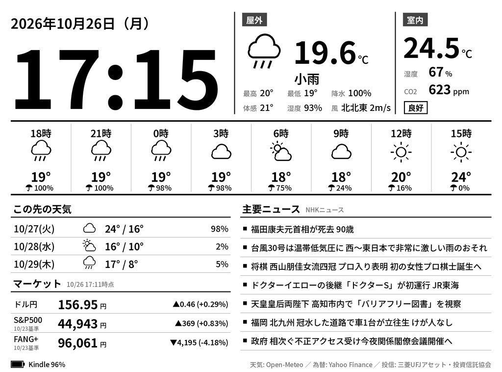

# Kindle ダッシュボード（Kindle Paperwhite 2 / 第6世代向け）

古い Kindle を「時計・天気・室内環境・市況・ニュース」の E-ink ダッシュボードにする。
調査・脱獄手順は [docs/kindle-dashboard/](../docs/kindle-dashboard/)（PW2 専用手順: [paperwhite2.md](../docs/kindle-dashboard/paperwhite2.md)）。



（ダミーデータで描画したプレビュー。実機では 90° 回転した 758×1024 の画像が表示される）

## 仕組み

```
server/ (PC・Raspberry Pi)                         kindle/ (脱獄済み Kindle)
  Open-Meteo / Yahoo Finance / NHK RSS / SwitchBot      KUAL ▸ Dashboard ▸ Start
        │ 5〜15分ごとに取得（失敗時は前回値）              │ 毎分 0 秒すぎに
        ▼                                               ▼
  GET /dash.png ──── その時刻で描画した PNG ────────▶ wget → eips/fbink で表示
        ▲                                               │
        └──────── ?battery=96&charging=1 ◀───────────────┘ （電池残量を画面下に表示）
```

- 描画はすべてサーバー側（Python + Pillow）。Kindle は画像を貼るだけ。
- 時計はリクエストのたびにその時刻で描くので、Kindle が毎分取りに来れば分単位で正確。
- 15 回に 1 回は全面リフレッシュして残像を消す。

## 1. サーバーを動かす

### A. NAS の Docker で動かす（おすすめ）

NAS に Docker（Synology の Container Manager、QNAP の Container Station など）が入っていれば、
`server/` フォルダだけで動く。フォントはイメージ作成時に自動で取得する（NAS からインターネットへの接続が必要）。

1. **NAS にファイルを置く**: `kindle_dashboard/server` フォルダの中身を NAS の共有フォルダへコピー
   （例: Synology なら File Station で `/docker/kindle-dashboard/` を作ってそこへ。`git clone` してもよい）。
2. **設定ファイルを作る**: 同じ場所に `config` フォルダを作り、`config.example.json` を
   `config/config.json` という名前でコピーして、`location`（緯度・経度）を自宅に合わせる。
   （`config/config.json` が無くても東京の設定で起動する）
3. **起動する**
   - **Synology (DSM 7.2 以降)**: Container Manager → プロジェクト → 作成 →
     パスに手順 1 のフォルダを指定 →「既存の docker-compose.yml を使用」→ 次へ → 完了。
     イメージのビルドと起動が自動で行われる。
   - **QNAP / その他**: NAS に SSH でログインして
     ```bash
     cd /share/Container/kindle-dashboard   # 手順 1 のフォルダ
     docker compose up -d --build           # 古い環境では docker-compose up -d --build
     ```
4. **確認**: PC のブラウザで `http://<NASのIP>:8080/preview.png` を開く。
   `http://<NASのIP>:8080/health` で各データの取得状況（`ok: true/false`）が見られる。
5. Kindle の `config.sh` の `SERVER_URL` を `http://<NASのIP>:8080/dash.png` にする。
   **NAS の IP はルーターで固定**しておくと安心。

その他:
- 設定を変えたら Container Manager でプロジェクトを再起動（SSH なら `docker compose restart`）。
- プログラムを更新したら、ファイルを差し替えて再ビルド（SSH なら `docker compose up -d --build`）。
- ポート 8080 が使用中なら `docker-compose.yml` の `"8080:8080"` の左側を変える（例 `"8090:8080"`）。
- NAS のファイアウォールを有効にしている場合は、そのポートを LAN 内に許可する。
- SwitchBot を使うなら `.env.example` を `.env` にコピーしてトークンとシークレットを書く。
- ログ: Container Manager のコンテナ詳細 →「ログ」、または `docker logs kindle-dashboard`。

### B. PC / Raspberry Pi で直接動かす

Python 3.9 以上が必要。

```bash
cd kindle_dashboard/server
pip install -r requirements.txt
./fetch_fonts.sh                 # 日本語フォント（Noto Sans JP）を取得
cp config.example.json config.json
# config.json の location（緯度・経度）を自宅に合わせる

python serve.py render --demo    # out/preview.png でデザインを確認（通信なし）
python serve.py render           # 実データで 1 枚描画（取得結果も表示）
python serve.py                  # 配信開始 → 表示された http://<IP>:8080/dash.png を控える
```

- ブラウザで `http://<IP>:8080/preview.png`（横向き確認用）と `/health`（各データの取得状況・Kindle の電池）を開ける。
- 常時起動は Raspberry Pi などで `kindle-dashboard.service`（systemd の設定例）を使う。
- Windows で「ファイアウォールの許可」が出たらプライベートネットワークを許可。
- フォントは `fetch_fonts.sh` が使えない環境では、`config.json` の `font_path` に手元の日本語フォント（例: `C:/Windows/Fonts/meiryo.ttc`）を指定してもよい（太さの切り替えは可変フォントのみ）。

### config.json

| 項目 | 内容 |
|---|---|
| `location` | 地名・緯度・経度（Google マップで右クリックすると表示） |
| `display.rotate` | Kindle 用画像の回転（時計回り 0/90/180/270）。表示が逆さなら 270 に |
| `refresh_minutes` | データ源ごとの取得間隔（分） |
| `news.url` | RSS の URL。NHK のカテゴリ別 RSS などに変更可 |
| `market.symbols` | マーケット欄に出す 3 銘柄（下記） |
| `indoor` | 室内センサー。SwitchBot を使うなら下記 |

### マーケット欄（ドル円・eMAXIS Slim 米国株式(S&P500)・iFreeNEXT FANG+）

既定では次の 3 つを表示する。投資信託は 1 日 1 回（営業日の夜）更新される基準価額で、ラベルの下に基準日を出す。

| 表示 | 中身 | 取得元 (`source`) |
|---|---|---|
| ドル円 | USD/JPY（ほぼリアルタイム） | `yahoo`: Yahoo Finance（非公式 API）`"symbol": "JPY=X"` |
| S&P500 | eMAXIS Slim 米国株式（S&P500）の基準価額 | `mufg`: 三菱UFJアセットマネジメント公式「投信情報 API」`"code": "03311187"`（協会コード） |
| FANG+ | iFreeNEXT FANG+インデックスの基準価額 | `toushin`: 投資信託協会「投信総合検索ライブラリー」の CSV `"isin": "JP90C000FZD4", "code": "04311181"` |

- 他の投資信託に替えるときは `toushin` を使えば運用会社を問わず取得できる。ISIN と協会コード（8 桁）は
  [投信総合検索ライブラリー](https://toushin-lib.fwg.ne.jp/FdsWeb/) や Yahoo!ファイナンスのファンドページで調べられる。
- 投資信託ではなく NYSE FANG+ 指数そのものを出したい場合は `{"label": "FANG+", "source": "yahoo", "symbol": "^NYFANG", "unit": "pt", "decimals": 0}` に替える。
- `refresh_minutes` を銘柄ごとに指定できる（投資信託は 60 分）。

### 室内センサー（任意: SwitchBot）

1. SwitchBot アプリ → プロフィール → 設定 → 「アプリバージョン」を 10 回タップ → 開発者向けオプションでトークンとシークレットを取得。
2. 環境変数 `SWITCHBOT_TOKEN` と `SWITCHBOT_SECRET` を設定。
3. `config.json` を `"indoor": {"provider": "switchbot", "device_id": "<CO2センサーのデバイスID>"}` に。
   デバイス ID は `GET https://api.switch-bot.com/v1.1/devices` の一覧で確認できる。
4. CO2 は 1000ppm 未満「良好」、1500ppm 未満「やや高い」、それ以上「換気推奨」と表示。

## 2. Kindle に入れる

前提: 脱獄済み・KUAL 導入済み（[paperwhite2.md](../docs/kindle-dashboard/paperwhite2.md)）、Wi-Fi 設定済み・機内モード OFF。

1. USB で接続し、`kindle/extensions/dashboard` フォルダを Kindle の `extensions/` にコピー。
2. `extensions/dashboard/config.sh` の `SERVER_URL` を、サーバー起動時に表示された URL に書き換える。
   **改行コードは LF のまま保存**（Windows のメモ帳なら右下を「LF」に。VS Code 推奨）。
3. 取り外して KUAL → **Dashboard → Test (1回表示)** で画像が出るか確認。
4. 問題なければ **Dashboard → Start**。以後、毎分更新される。

終了方法: **電源ボタンを押す**（ダッシュボードを終了して通常の Kindle に戻る）／SSH で `sh /mnt/us/extensions/dashboard/bin/stop.sh`／再起動。

### config.sh

| 項目 | 内容 |
|---|---|
| `SERVER_URL` | 画像の URL（LAN 内は http） |
| `INTERVAL` | 更新間隔（秒）。60 なら毎分 0 秒すぎに合わせる |
| `FULL_REFRESH_EVERY` | 何回に 1 回全面リフレッシュするか |
| `STOP_MODE` | `pause`（UI を一時停止, 既定）／ `stop`（UI を停止）。表示が上書きされるなら `stop` に |
| `FRONTLIGHT` | フロントライトの明るさ（0 で消灯、空なら変更しない） |
| `EXIT_ON_POWER_BUTTON` | 1 なら電源ボタンで終了 |
| `LOG_FILE` | ログ。不調時は USB 接続して `extensions/dashboard/dashboard.log` を見る |

FBInk が入っていれば FBInk、なければ標準の `eips` で表示する。

## 3. 開発

```bash
cd kindle_dashboard/server
pip install -r requirements-dev.txt
python -m pytest -q
```

Kindle 側スクリプトは `lipc-*`・`eips` などをスタブにすれば PC 上でも動作確認できる（`sh` / BusyBox ash 互換で記述）。

## 検証状況

- ✅ サーバー: 単体テスト（API 応答の解析、描画、回転、16 階調化、HTTP 配信、電池残量の受け取り）とダミーデータでの描画。
- ✅ Docker: イメージのビルド、コンテナ起動、`/dash.png`・`/health` の応答、ヘルスチェック、非 root 実行、`/config` の設定読み込み。
- ✅ Kindle 側: コマンドをスタブにした PC 上のシミュレーションで、取得 → 全面/部分リフレッシュ → 停止で UI 復帰までを確認。
- ⚠️ 実 API（Open-Meteo / Yahoo Finance / 三菱UFJアセット / 投資信託協会 / NHK RSS / SwitchBot）は開発環境から接続できず未確認。応答形式は公開仕様・公開事例に合わせてある。NAS で起動後に `/health` で取得結果が確認できる。
- ⚠️ Kindle 実機（PW2, FW 5.12.2.2）では未検証。特に `STOP_MODE`、電源ボタンでの終了、FBInk のパスは実機で確認が必要。
