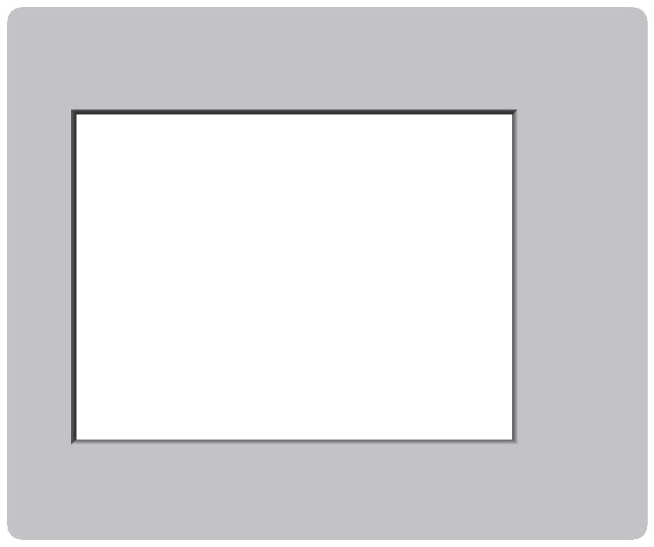
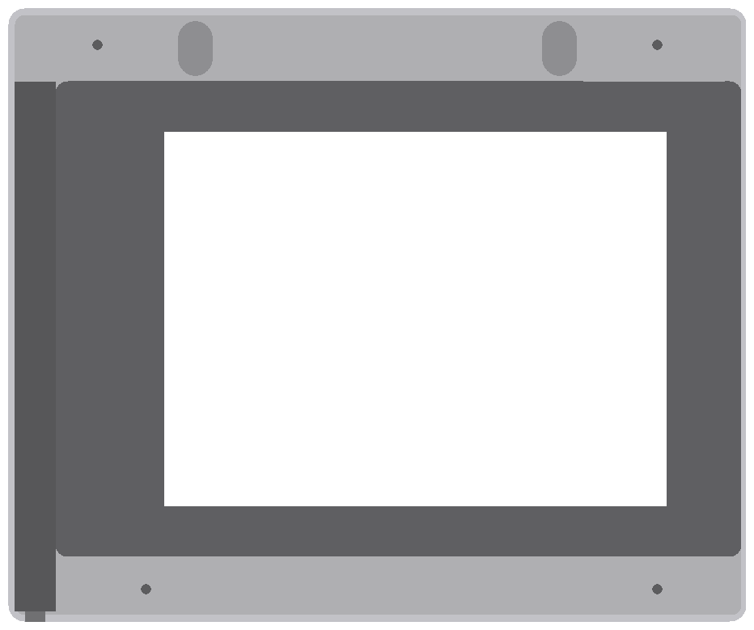

# 壁掛けフレーム（Kindle Paperwhite 第7世代・Bambu Lab A1 mini）

横置きで、Kindle のロゴ（充電端子・電源ボタンのある辺）が右側に来る向きです。
ケーブルは**右下の底面から下向きに**出ます。

全体の幅は 182.4mm で、A1 mini の 180mm を少し超えます。そのため額は**本体（177mm）と左端の細い帯（5.4mm）**に分けて印刷し、
フィラメント片のピンと接着剤でつなぎます。

| 部品 | ファイル | 大きさ | 印刷の向き |
|---|---|---|---|
| 額の本体 | `stl/frame.stl` | 177 × 151.6 × 14 mm | **前面（画面側）を下**。サポートなし |
| 左端の帯 | `stl/frame_side.stl` | 5.4 × 151.6 × 14 mm | 前面を下（本体と同じ向き）。本体と同じプレートに並べてよい |
| 裏ぶた | `stl/back.stl` | 175 × 148 × 2.9 mm | そのまま（外側の面が下） |
| お試し | `stl/fit_test.stl` | 177 × 151.6 × 3 mm | 前面を下。20 分ほど |

 

## 仕組み

```
  ┌──┬────────────────────────────────────┬─────┐
  │帯│  ┌────────────────────────┐ Kindle │     │← ケーブル室（幅 10mm・奥行 11.6mm）
  │  │  │        画面の窓        │ ロゴ側 ●┤┐    │   ● 端子に L字アダプタを挿す
  │  │  │                        │        │┃    │   ┃ アダプタは下向きに伸びる
  │  │  └────────────────────────┘        │▼    │   ▼ その先にふつうの micro-USB ケーブル
  └──┴────────────────────────────────────┴─┃───┘
                                             ┃ 底面の切り欠きから外へ
```

- 端子に L字の変換アダプタを挿し、アダプタの先にふつうのまっすぐな micro-USB ケーブルを挿します。ケーブルは右側のケーブル室を通って、右下の底面から出ます。
- 底面の出口は裏側に開いた切り欠きです。ケーブルを裏から落とし込み、裏ぶたで押さえます。
- 電源ボタンは右の側面の縦スリット（端子の 6〜32mm 上）から、つまようじなどで押せます。
- 壁へは、裏ぶたの鍵穴 2 つ（間隔 90mm）を壁のねじ 2 本に引っかけます。

## 買うもの

| 物 | 数 | 用途 |
|---|---|---|
| オーディオファン microUSB 方向変換アダプター L字 D（約 21×9×13mm、2 個入り） | 1 | 端子からケーブルを下へ向ける |
| ふつうの micro-USB ケーブル（まっすぐ、1〜2m、充電対応）。**プラグの樹脂部分が厚さ 7mm・幅 11mm 以内**のもの | 1 | 給電 |
| USB 電源（5V 1A 以上） | 1 | 常時給電 |
| M3 × 8〜10mm **皿**タッピングねじ | 4 | 裏ぶたの固定 |
| 壁用ねじ（**頭の径 8mm 以下・軸 4mm 以下**、例: 3.5×25mm なべ）＋石膏ボード用アンカー | 2 | 壁掛け。90mm 間隔・水平に、壁から 3mm ほど出しておく |
| 1.75mm フィラメントの切れ端（長さ 9mm × 4 本） | – | 帯と本体をつなぐピン |
| 瞬間接着剤（PLA に使えるもの） | 少量 | 帯と本体の接着 |
| （任意）薄いスポンジテープ 1mm | – | Kindle ががたつくとき裏ぶたの帯に貼る |

### アダプタが届いたら最初に確認すること

1. **Kindle に挿したとき、アダプタの本体が下向きに伸びるか**（スクリーンを手前・ロゴを右にした状態で）。
   - 上向きに伸びる場合は、`case.py` の `PORT_SIDE = "left"` にして作り直します。Kindle は逆さ（ロゴが左）に入れ、
     サーバーの `config.json` で `"display": {"rotate": 270}` にします。
2. **Kindle の側面からアダプタの外側までの長さ**（7〜8mm の見込み）。9mm を超えるようなら `CHAMBER_W` を広げます。
3. アダプタを挿したまま**充電と表示ができるか**。

## 印刷（Bambu Studio）

- 材料: PLA（マット黒・白が額らしい）。日の当たる窓際なら PETG。
- 積層 0.2mm、壁 3 周、インフィル 15%、**サポートなし**。
- **ブリム・スカートは切る**（本体は 177mm で A1 mini の 180mm ぎりぎり）。プレートの中央に置く。
- 本体と左端の帯は、どちらも前面を下にして同じプレートに並べられます（帯を 90° 回して本体の下に置く）。
- テクスチャ PEI プレートなら、前面がシボ仕上げになってきれいです。
- 時間の目安: 本体＋帯 約 4〜5 時間、裏ぶた 約 2 時間。

### まず `fit_test.stl` を印刷する

画面の位置は写真からの推定値なので、20 分のお試しで確かめます（左端の帯の分、左の縁は 5.4mm 欠けています）。

1. Kindle をお試しの上に置き、**窓の中に表示部がちょうど収まり、黒い縁が見えない**か見る。
2. Kindle の外形が、壁の根元（1mm 分）にきつすぎずに入るか。
3. ずれていたら `case.py` 上部の数字を直して `python case.py` で作り直す:
   - 窓が左右にずれる → `SCREEN_LEFT`、上下にずれる → `SCREEN_BOTTOM`
   - 窓が小さい／大きい → `WINDOW_MARGIN`
   - きつい／ゆるい → `FIT`

```bash
pip install manifold3d trimesh numpy
python case.py           # stl/ を作り直す
python render_preview.py # 確認用の画像（任意, Pillow が必要）
```

## 組み立て

1. **帯をつける**: 本体と帯の境目のピン穴 4 つにフィラメント片（9mm）を差し、接着剤を塗って帯を押し当てる。
   前面がそろうように平らな机の上で押さえ、乾かす。
2. アダプタを Kindle の端子に挿し、その先に micro-USB ケーブルを挿す。
3. Kindle を、画面を下にして額に入れる（ロゴ側が右）。アダプタとケーブルのプラグはケーブル室に入る。
4. ケーブルをケーブル室に沿わせ、底面の切り欠きに裏から落とし込む。
5. 裏ぶたをはめ、皿ねじ 4 本で留める（締めすぎない）。
6. 給電して表示を確認する。
7. 壁のねじ 2 本に鍵穴を通して、下へ引っかける。

電源ボタンは右の側面のスリットから細い棒で押します（Dashboard 停止のとき）。
スリットとボタンの位置が合わないときは `BUTTON_SLOT`（端子の中心から上へ何 mm〜何 mm）を調整します。

## 変えられる主な寸法（`case.py` の先頭）

| 名前 | 既定 | 意味 |
|---|---|---|
| `PORT_SIDE` | `"right"` | 端子の側。`"left"` で左右を反転 |
| `CHAMBER_W` | 10.0 | ケーブル室の幅（アダプタの出っ張り＋余裕） |
| `CABLE_D` | 5.2 | 底面のケーブルの出口の幅 |
| `MAIN_MAX` | 177 | 本体の幅の上限（残りが左端の帯） |
| `BORDER_BOTTOM`, `BORDER_TOP` | 16, 18 | Kindle の下・上の額の幅 |
| `FRONT_T` | 2.0 | 前面の厚さ |
| `FIT` | 0.3 | Kindle の周りのすき間 |
| `SCREEN_LEFT`, `SCREEN_BOTTOM` | 19.0, 13.1 | 表示部の位置 |
| `KEYHOLE_SPACING` | 90 | 壁ねじの間隔 |
