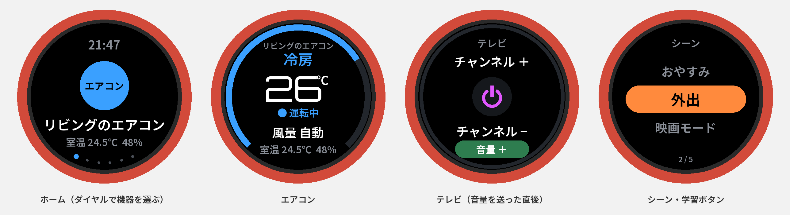

# まとめリモコン（M5Stack Dial ＋ SwitchBot ハブ2）

家じゅうの赤外線リモコンを、手のひらサイズの丸い画面＋ダイヤル 1 つにまとめる。
エアコンは本物のリモコンのように **設定温度・モード・風量・運転状態** を画面に出し、ダイヤルを回して温度を変える。



（画面のイメージ。`python3 tool/preview.py` で描き直せる。実機の描画は `firmware/src/main.cpp`）

## 仕組み

```
M5Stack Dial ──Wi-Fi──▶ SwitchBot クラウド API ──▶ ハブ2 ──赤外線──▶ エアコン・テレビ・照明…
   ▲                         │
   └──── 室温・湿度（ハブ2 のセンサー）、リモコン一覧、シーン一覧 ◀┘
```

- 赤外線を出すのは **すでにある SwitchBot ハブ2**。リモコンの学習・登録は SwitchBot アプリで済ませたものをそのまま使う。
- ダイヤル側は起動時に API から **リモコン一覧とシーン一覧を自動で読み込む**。機器を足したらボタン長押しで再読み込みするだけ。
- 赤外線は送りっぱなしで状態が返ってこないので、エアコンの設定はダイヤル側で覚えておき（電源を切っても残る）、
  `setAll`（温度・モード・風量・電源をまとめて送る）で毎回まるごと送る。本物のエアコンのリモコンと同じやり方。
- ハブ2 のある部屋にいなくても、Wi-Fi が届けばどこからでも操作できる。

## 買うもの

| もの | 目安 | 備考 |
|---|---|---|
| **M5Stack Dial**（SKU: K130） | 約 7,000 円 | スイッチサイエンス・秋月など。丸型 1.28 インチ タッチ画面・ロータリーエンコーダー・ブザー・ESP32-S3 入り。はんだ付け・配線は不要 |
| USB-C ケーブル | — | 書き込み用・給電用 |
| （任意）USB-C の充電器と短いケーブル | — | 置きっぱなしで使うなら常時給電がらく |
| （任意）リチウムポリマー電池 | — | Dial の裏に電池コネクタあり。コードレスで持ち歩くなら（下の「電池で使う」参照） |

SwitchBot ハブ2 と、そこに登録した赤外線リモコンが前提（Kindle ダッシュボードで使っているもの）。

## 作り方

### 1. 開発環境（PC で 1 回だけ）

1. [VS Code](https://code.visualstudio.com/) を入れて、拡張機能「**PlatformIO IDE**」を入れる。
2. この `universal_remote/firmware` フォルダを VS Code で開く（PlatformIO が必要なものを自動で取ってくる）。

コマンド派なら `pip install platformio` でもよい。

### 2. 設定ファイルを作る

```bash
python3 universal_remote/tool/remote_setup.py
# Kindle ダッシュボード用の secrets.json があれば、トークンを流用できる
python3 universal_remote/tool/remote_setup.py --secrets secrets.json
```

SwitchBot のトークン・シークレットと Wi-Fi（**2.4GHz**）の SSID・パスワードを入れると、
登録済みのリモコンと「どの画面になるか」を一覧にして、`firmware/include/config.h` を書き出す。
（手で作るなら `config.example.h` を `config.h` にコピーして書き換える。`config.h` は Git に入らない）

### 3. 書き込む

Dial を USB-C で PC につないで:

- VS Code: 画面下の PlatformIO の「→（Upload）」
- コマンド: `cd universal_remote/firmware && pio run -t upload`

書き込めないときは、中の StampS3 の **G0 ボタンを押しながら USB を挿し直す** と書き込みモードになる（場所は M5Stack 公式の Dial のページを参照）。
ログは `pio device monitor`（エラー時の HTTP コードなどが出る）。

### 4. 起動

「Wi-Fi 接続中 → 時刻合わせ → リモコン一覧を読み込み中」と出て、ホーム画面になれば完了。

## 使い方

| 画面 | ダイヤル | 画面タップ | ボタン（ダイヤル中央を押す） |
|---|---|---|---|
| **ホーム** | 機器を選ぶ | 開く | 開く／**長押しで再読み込み** |
| **エアコン** | 設定温度（16〜30℃） | 上=モード（冷房→暖房→除湿→送風→自動）／真ん中=運転・停止／下=風量 | ホームへ |
| **テレビ** | 音量 | 上=チャンネル＋／真ん中=電源／下=チャンネル− | ホームへ |
| **オーディオ** | 音量 | 上=再生／真ん中=電源／下=一時停止 | ホームへ |
| **照明** | 明るさ | 上=全灯／真ん中=点灯・消灯／下=消灯 | ホームへ |
| **扇風機** | 風量（弱・中・強） | 上=首振り／真ん中=運転・停止／下=タイマー | ホームへ |
| **一覧**（DIY・その他・シーン） | 項目を選ぶ | 送る | ホームへ |

- 機器の画面で **左右にはらう** と隣の機器へ。
- 機器の画面を **長押し** すると「電源 ON/OFF ＋ 学習ボタン」の一覧になる（もう一度長押しかボタンで戻る）。
- エアコンの温度・モード・風量は、回し終わって 0.7 秒たってから 1 回だけ送る（回している途中で何度もピッピッ鳴らない）。
  停止中に変えた設定は覚えるだけで、次に「運転」したときその設定で動く。
- 20 秒で暗く、60 秒で消灯。触るかダイヤルを回すと点く（点けた操作は送らない）。
- 送れなかったときは赤い表示とブザー（例:「ハブがオフライン」「回数制限」）。

### 学習ボタン（アプリでリモコンに追加したボタン）

`config.h` の `CUSTOM_BUTTONS` に `{"アプリでのリモコン名", "ボタン名"}` で並べる（名前は 1 文字も違わないように）。
DIY・その他のリモコンは、ここに書いたボタンが一覧に出る。

```c
static const char* const CUSTOM_BUTTONS[][2] = {
    {"リビングの照明", "常夜灯"},
    {"テレビ", "入力切替"},
    {nullptr, nullptr},  // 最後の印（消さない）
};
```

## 調整

`config.h` の下の方:

| 項目 | 内容 |
|---|---|
| `ENCODER_STEPS_PER_CLICK` | 1 カチッで 2 段動く → 8、4 カチッで 1 段 → 1 |
| `ENCODER_DIRECTION` | 右に回して温度が下がるなら `-1` |
| `DIM_AFTER_MS` / `SLEEP_AFTER_MS` | 暗くなるまで・消えるまで |
| `BRIGHTNESS` | 画面の明るさ |
| `BEEP` | 0 で操作音なし |
| `SENSOR_DEVICE_ID` | 室温を別の温湿度計から取りたいとき |

## 困ったとき

| 症状 | 対処 |
|---|---|
| Wi-Fi につながらない | 5GHz の SSID になっていないか。ESP32 は 2.4GHz のみ |
| 「トークンが違います」 | トークン・シークレットを取り直して `config.h` を作り直す |
| 「読み込めませんでした / 通信エラー」 | 時刻が合っていないと署名が通らない。ルーターが NTP を止めていないか |
| 「未対応のコマンド」 | その機器の種類では使えないボタン。長押しの一覧から学習ボタンで送る |
| エアコンの表示と実機がずれた | 本物のリモコンで操作したときなど。Dial で一度「運転」を送り直せば揃う |
| 「回数制限」 | SwitchBot API は 1 日 1 万回まで。室温の取得（5 分ごと）＋操作なら普通は届かない |

## 電池で使う

Dial は電池コネクタがあるので、電池をつなげばコードレスで持ち歩ける。ただし今のファームウェアは
画面を消すだけで Wi-Fi はつないだまま（すぐ操作できる代わりに電池は 1 日もたない）。
置きっぱなしの常時給電がおすすめ。電池運用にするなら、消灯後にディープスリープしてダイヤル・タッチで起きる作りに変える。

## ファイル

```
firmware/
  platformio.ini              ビルド設定（M5Dial・M5Unified・ArduinoJson）
  src/main.cpp                画面と操作
  src/switchbot.{h,cpp}       SwitchBot API（署名・一覧・送信・室温）
  lib/remote_core/            画面や通信に依存しない部分（エアコンの状態・コマンド・間引き）
  test/test_core/             ↑ のテスト（PC で `pio test -e native`）
  include/config.example.h    設定の見本 → config.h にコピー
  include/root_ca.h           SwitchBot API の証明書を確かめるルート証明書
tool/
  remote_setup.py             config.h を作る（リモコン一覧の確認つき）
  preview.py                  画面イメージ（docs/preview.png）を描く
```

## 今後やれること

- 赤外線 LED を Dial の Port A（Grove）につなぎ、**ハブを通さず直接送る**（クラウド不要・速い）。
  そのときは学習用に赤外線受信モジュールも足す（M5Stack の IR Unit なら 1 個で送受信できる）。
- ハブ2 の Matter / ローカル API が使えるようになったら、クラウドを通さずに送る。
- SwitchBot の Webhook で、アプリや本物のリモコンからの操作も画面に反映する。
